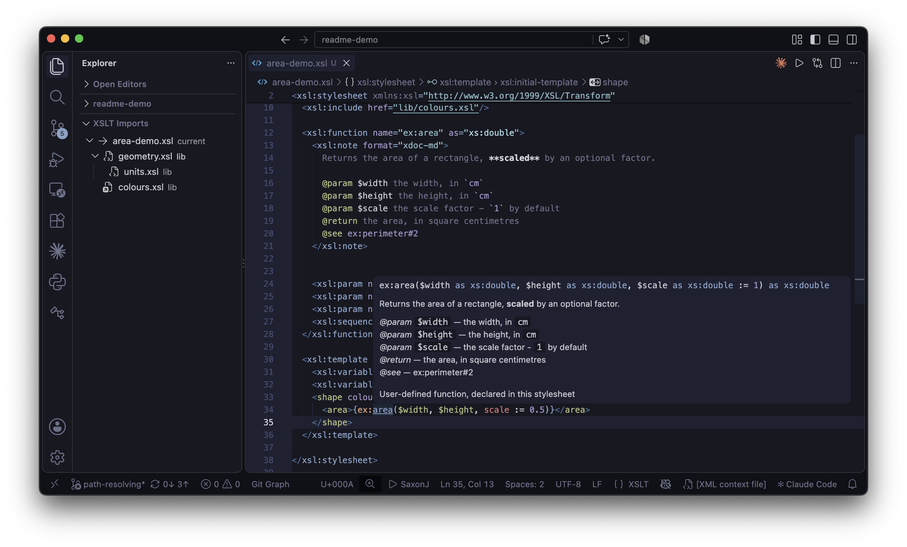
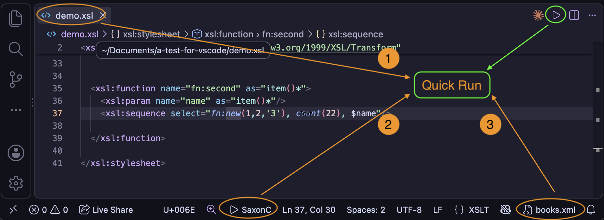
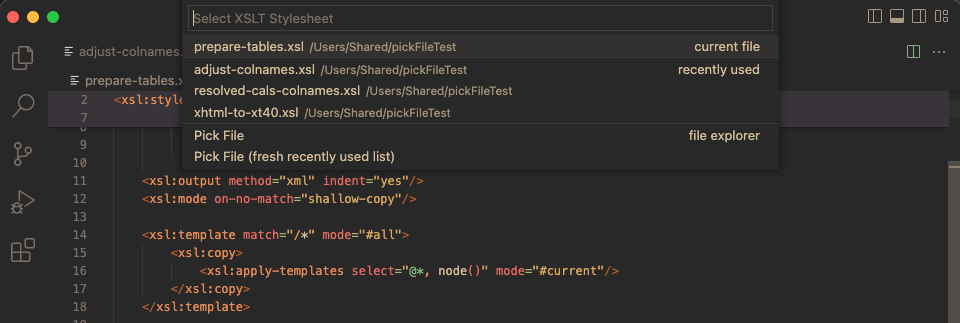

[](https://www.deltaxml.com/?utm_source=VisualStudio&utm_medium=Dev-Tools&utm_campaign=XSLT-XPATH)
# XSLT/XPath for Visual Studio Code

The XSLT/XPath extension for VSCode provides comprehensive language support for XSLT 3.0 and XPath 3.1, and for the XSLT 4.0 and XPath 4.0 features implemented in Saxon 13. This ReadMe is merely a 'quick start' guide, see the [XSLT/XPath User Guide](https://deltaxml.github.io/vscode-xslt-xpath/) for more comprehensive help.

---

<p align="center">
  <em>XSLT 4.0 with a documentation note, its hover help where the function is called, and the XSLT Imports view:</em>
  
</p>


# Features

This release adds full support for XSLT 4.0 in Saxon 13 - see [Release 2.0 Highlights](https://deltaxml.github.io/vscode-xslt-xpath/new-release.html).

<table>
<tr>
  <td width="50%" valign="top">
    <h4><a href="https://deltaxml.github.io/vscode-xslt-xpath/xslt40.html">XSLT &amp; XPath languages</a></h4>
    <ul>
      <li><a href="https://www.w3.org/TR/xslt-30/">XSLT 3.0</a> and XPath 3.1</li>
      <li><a href="https://qt4cg.org/2026-01-28/xslt-40/Overview.html">XSLT 4.0</a> and XPath 4.0, as in 
      <a href="https://www.saxonica.com/html/documentation13/changes/v13/xslt40.html">Saxon 13</a></li>
      <li>SaxonJS interactive extensions (IXSL)</li>
      <li><code>.xpath</code> files, as XPath 4.0</li>
      <li>Fast semantic highlighting</li>
    </ul>
  </td>
  <td width="50%" valign="top">
    <h4><a href="https://deltaxml.github.io/vscode-xslt-xpath/xslt40-records.html">XSLT 4.0</a></h4>
    <ul>
      <li>Record and enum types, with type-aware checks</li>
      <li>Named item types: <code>xsl:item-type</code></li>
      <li><code>xsl:switch</code>, with missing-case quick fixes</li>
      <li>Keyword arguments and optional parameters</li>
      <li>Functions in no namespace</li>
    </ul>
  </td>
</tr>
<tr>
  <td width="50%" valign="top">
    <h4><a href="https://deltaxml.github.io/vscode-xslt-xpath/editing-xslt.html#intellisense">Editing</a></h4>
    <ul>
      <li>Context-aware auto-completion, incl. node names</li>
      <li>Signature help and hover help</li>
      <li>Snippets, incl. new stylesheets for 3.0 and 4.0</li>
      <li>Formatting of instructions and multi-line XPath</li>
      <li>Rename symbol, across imported modules</li>
      <li>Semantic highlighting from a full XPath parser</li>
    </ul>
  </td>
  <td width="50%" valign="top">
    <h4><a href="https://deltaxml.github.io/vscode-xslt-xpath/xslt40-notes.html">Code documentation</a></h4>
    <ul>
      <li><code>xsl:note</code> with Markdown and xqDoc-style tags</li>
      <li>Shown in hover and signature help</li>
      <li><code>@see</code> references, with navigation and rename</li>
      <li>Checks of <code>@param</code> and <code>@field</code> tags</li>
      <li>Module notes for stylesheets</li>
      <li>Highlighting and auto completion for tags or references</li>
    </ul>
  </td>
</tr>
<tr>
  <td width="50%" valign="top">
    <h4><a href="https://deltaxml.github.io/vscode-xslt-xpath/editing-xslt.html#checking">Linter</a></h4>
    <ul>
      <li>XPath syntax and XSLT instructions</li>
      <li>Types, records, enums and function arguments</li>
      <li>Unused XSLT and XPath variables or parameters</li>
      <li>References across imported modules</li>
      <li>Saxon errors from runs, in the Problems panel</li>
      <li>Quick fixes for common problems</li>
    </ul>
  </td>
  <td width="50%" valign="top">
    <h4><a href="https://deltaxml.github.io/vscode-xslt-xpath/navigation.html">Navigation</a></h4>
    <ul>
      <li>Go to (or peek) definition, and find references</li>
      <li>Go to the declarations of record fields</li>
      <li>Outline, breadcrumbs and Go to Symbol</li>
      <li>Links for <code>xsl:import</code> and <code>xsl:include</code></li>
      <li>XSLT Imports view, with inferred top-level stylesheets</li>
      <li>Filterable dropdown listing all symbols and modes</li>
    </ul>
  </td>
</tr>
<tr>
  <td width="50%" valign="top">
    <h4><a href="https://deltaxml.github.io/vscode-xslt-xpath/refactoring-xslt.html">Refactoring</a></h4>
    <ul>
      <li>Context-aware with safe symbol renaming</li>
      <li>Extract <code>xsl:function</code> or <code>xsl:template</code></li>
      <li>Extract <code>xsl:variable</code> from an XPath expression</li>
      <li>Extract a record type from a map</li>
      <li><strong>Wrap with...</strong> an instruction (<code>⌥⇧W</code> / <code>Alt+Shift+W</code>)</li>
      <li>Add a documentation note</li>
    </ul>
  </td>
  <td width="50%" valign="top">
    <h4><a href="https://deltaxml.github.io/vscode-xslt-xpath/quick-run.html">Running XSLT</a></h4>
    <ul>
      <li><strong>Quick Run</strong> (<code>⌘⌥R</code> / <code>Ctrl+Alt+R</code>)</li>
      <li>Tasks for SaxonJ, SaxonJS and SaxonC</li>
      <li><code>xsl:param</code> defaults pre-filled by Quick Run</li>
      <li><code>xsl:param</code> values controlled by tasks</li>
      <li>XML catalogs for <code>xsl:import</code> URIs</li>
      <li>File pickers for task inputs</li>
    </ul>
  </td>
</tr>
<tr>
  <td width="50%" valign="top">
    <h4><a href="https://deltaxml.github.io/vscode-xslt-xpath/code-diagnostics.html">Debugging &amp; tools</a></h4>
    <ul>
      <li><code>xsl:message</code> for all in-scope variables</li>
      <li>Formatted, colored output with <code>xdm:debug()</code></li>
      <li>Companion <a href="https://marketplace.visualstudio.com/items?itemName=deltaxml.xpath-notebook">XPath Notebook</a> extension</li>
      <li>Test XPath against the current XML file</li>
      <li>The full <a href="https://deltaxml.github.io/vscode-xslt-xpath/">User Guide</a></li>
    </ul>
  </td>
  <td width="50%" valign="top">
    <h4><a href="https://deltaxml.github.io/vscode-xslt-xpath/editing.html">XML editing</a></h4>
    <ul>
      <li>Well-formedness and namespace checks</li>
      <li>Formatting and tree-view outline</li>
      <li>Auto tag-close, tag rename and self-close</li>
      <li>Comment command (<code>⌘/</code>)</li>
      <li>XML snippets</li>
    </ul>
  </td>
</tr>
</table>

\* *Problem-reporting currently depends on the VSCode symbol-provider. To ensure problems are always reported in VSCode, use the following VSCode setting: `"breadcrumbs.enabled": true`*

# XML Commands

The XML selection commands are also in the **XML Selection** submenu of the editor's context menu (right-click), and in the **XML: Select Element...** quick pick (`⇧⌘2` / `Ctrl+Shift+2`) - both show their key-bindings.

| Command  | Key-Binding (macOS / Windows, Linux) | Details |
| ------- | ------- | --------- |
| XML: Goto XPath |  | Initially shows current XPath at the text prompt  |
| XML: Select Element... | ⇧⌘2 / Ctrl+Shift+2 | Quick pick of the XML selection commands, and Goto XPath |
| XML: Select current element | ⇧⌘0 / Ctrl+Shift+0 | Includes start/end tags |
| XML: Select parent element | ⇧⌘9 / Ctrl+Shift+9 | Includes start/end tags |
| XML: Select first child element | ⇧⌘8 / Ctrl+Shift+8 | Includes start/end tags |
| XML: Select following element | ⇧⌘7 / Ctrl+Shift+7 | Includes start/end tags |
| XML: Select preceding element | ⇧⌘6 / Ctrl+Shift+6 | Includes start/end tags |
| XSLT: Add XSLT Inputs to Tasks File ||For file-selection prompt when running XSLT|
| New XPath Notebook | - | DeltaXignia's [XPath Notebook extension](https://marketplace.visualstudio.com/items?itemName=deltaxml.xpath-notebook) is required

 # Introduction
 
For lexical analysis, this extension processes code character-by-character. This analysis is exploited for all features including *all* syntax highlighting. Avoiding the much more common use of regular expressions on a line-by-line basis brings significant benefits. These benefits include improved responsiveness, lower CPU load, improved code maintainability and greater integrity for syntax highlighting.

**Auto-completion** is provided for XSLT and XPath. This includes context-aware completion items for all code symbol names. XSLT and XPATH function signatures and descriptions are shown in the description alongside function completion items. The last active non-XSLT file is used as the source to compute available node names for XPath location steps.

This extension's linter performs a comprehensive set of checks on the code. The linter ensures that any code symbols within XSLT or XPath with problems are accurately identified at the symbol-level. Asynchronous processing for xsl:include/xsl:import dependencies allows checking of references to symbol definitions regardless of the location of the definition.

# Running XSLT



*(1) XSLT in active editor, (2) the Saxon processor, (3) the XML context file - click the play button to run*

The quickest way to run the stylesheet in the active editor is [Quick Run](https://deltaxml.github.io/vscode-xslt-xpath/quick-run.html) (`⌘⌥R` / `Ctrl+Alt+R`): the first run creates a task for you, which later runs reuse.

XSLT transforms for SaxonJava, SaxonJS and SaxonC are configured and run as special VSCode Tasks. 

XSLT task JSON properties can reference special commands. The special commands allow file-selection via a File Explorer or 'Recent Files' list, an example using: `"xsltFile": "${command:xslt-xpath:pickXsltFile}"`. A sample screenshot is shown below:



For more a full description on using VSCode tasks to run XSLT, see [Running XSLT](https://deltaxml.github.io/vscode-xslt-xpath/run-xslt.html).

## Debugging XSLT

Stylesheets can be debugged with SaxonJ (Saxon 12 or later, any edition, including Saxon-HE): set breakpoints in the stylesheet, then use **XSLT: Debug Stylesheet with SaxonJ** (the debug button in the editor title, or `F5` with no `launch.json`). As with Quick Run, the stylesheet runs with the XML context file - or from `xsl:initial-template` - using the Quick Run task, so parameters added to the task also apply when debugging.

- Breakpoints, including conditional breakpoints - an XPath condition, evaluated where the breakpoint is, and/or a hit count: `5` (the 5th hit), `>5`, `>=5`, `<5`, `<=5` or `%5` (every 5th), counting hits where the condition is true - and logpoints (`{xpath}` in the message is replaced by its value). A breakpoint anywhere on a multi-line start tag is shown, and stops, at the tag's first line; one where there's no instruction to stop at (a comment, text, `xsl:note`, a declaration, or a child such as `xsl:sort`) is shown as unverified
- Multi-line XPath expressions (in `select`, `test` and `value` attributes) can be stepped through: **Step Into** at the instruction, or set a breakpoint on a line of the expression. The expression is evaluated separately, in the instruction's context, so that each part reports its own line - it appears in the call stack as, for example, `xsl:variable/@select (XPath)`, and its result is shown in the Debug Console. The instruction itself then runs as usual. An inline function's body is stepped through each time it's called, e.g. by `fold-left()`
- Step Over, Step Into and Step Out - the call stack shows template rules, named templates, functions and global variables, and `xsl:for-each`, `xsl:for-each-group` and `xsl:iterate` instructions
- The Variables view shows local variables and parameters (including tunnel parameters), the context item, `position()` and `last()`, and global variables and parameters - nodes, maps, arrays and sequences can be expanded
- Inline values: while paused, the value of each variable declared earlier in the template or function - `xsl:variable` and `xsl:param`, and in XPath, `let`, `for`, `some` and `every` bindings and inline function parameters - is shown at the end of its declaration's line (the `debug.inlineValues` setting turns this off)
- XPath expressions are evaluated in the Watch view and the Debug Console, with the in-scope variables, namespaces, context item and the stylesheet's functions - `current()`, `current-group()`, `current-grouping-key()` and `regex-group()` give their values where execution is paused; hover over a variable to see its value
- Dynamic errors - including `xsl:message` with `terminate="yes"` - pause where they're raised, with the error's code and message and the variables there (**Dynamic Errors**, in the Breakpoints view); errors caught by `xsl:try` can pause too (**Errors Caught by xsl:try** - not with Saxon 12.4 or earlier)
- Saxon's error messages are linked to their location in the Debug Console, and the errors are listed in the Problems view, as for tasks
- The output written so far - the principal result and each `xsl:result-document` - opens beside the stylesheet at the first pause where there is some, and is updated at each pause (**XSLT: Show Debug Output**, or the debug toolbar, opens it at any time; the `XSLT.debug.openOutput` setting turns off opening it automatically). It's serialized as the result is, by Saxon, but indented for readability, in the language of its output method (XML, HTML, JSON or plain text); the result itself is written as the stylesheet says. The Variables view's **Output** scope shows which result is being written to - or that a temporary tree is being built - and the end of each
- `xsl:message` output, and the result when there is no `resultPath`, appear in the Debug Console

With no `launch.json`, the **Run and Debug** view offers **Debug Active Stylesheet** and a configuration for each `xslt` task in `tasks.json` - and **create a launch.json file** adds these to a new `launch.json`. A `launch.json` configuration uses the `xslt-saxon` debugger type with `"quickRun": true` (the active stylesheet, as Quick Run runs it), the same properties as an `xslt` task, or `"task"` set to the label of an `xslt` task in `tasks.json`:

```json
{
    "type": "xslt-saxon",
    "request": "launch",
    "name": "Debug report",
    "task": "report with books.xml",
    "stopOnEntry": false
}
```

The stylesheet is compiled without optimization when debugging, so that all variables can be inspected. Saxon still evaluates constant expressions when it compiles - e.g. an `xsl:if` whose test uses only constant values - and an instruction it removes that way can't be stopped at.

The **XSLT Debugger** log, in the Output panel, shows how each debug session was launched - the Java command line, the Saxon product, the Java runtime and the Saxon options used - and, when a session doesn't start, why: for example, Java isn't on the PATH, or the Saxon jar setting isn't a Saxon jar.

# Release Notes

The project changelog is maintained on the project wiki. See [Release Notes](https://github.com/DeltaXML/vscode-xslt-tokenizer/wiki/Release-Notes).

# Extension Settings

To benefit from this extension, it's essential to make a few updates to VS Code's User or Workspace settings to your specific needs and environment.
This section outlines the main settings associated with XSLT features.

For more details on how these settings are managed within VS Code see: [VSCode Settings](https://code.visualstudio.com/docs/getstarted/settings)

## XSLT Tasks

To use the task-provider for the _Java_ Saxon XSLT Processor, the following setting is required (alter path to suit actual jar location):

```
  "XSLT.tasks.saxonJar": "/path/to/folder/SaxonHE12-9J/saxon-he-12.9.jar"
```

To use the task-provider for SaxonC, set the path of the folder containing the SaxonC command-line `Transform` executable:

```
  "XSLT.tasks.saxonCPath": "/path/to/folder/containing/Transform"
```

## XSLT 4.0 Tasks

XSLT 4.0 requires Saxon-PE or Saxon-EE (or the equivalent SaxonC edition). The task property `allowSyntaxExtensions40` defaults to `"auto"`, which enables XPath 4.0 syntax unless the processor is Saxon-HE.

When the `parse-html()` function is used, the following setting is also needed, e.g.:

```
  "XSLT.tasks.htmlParserJar": "/path/to/folder/htmlparser-1.4.jar" // or: nu.validator.jar
```

## XSLT Packages

If your XSLT contains xsl:use-package instructions, XSLT package names are resolved to lookup symbols to support the following features:

- Goto Definition
- Symbol Diagnostics
- Symbol Auto-Completion

 To allow XSLT package names to be resolved to file paths, package details should be added to the setting:

`XSLT.resources.xsltPackages`

An example of XSLT package name settings:

```json
"XSLT.resources.xsltPackages": [
       { "name": "example.com.package1", "version": "2.0", "path": "included1.xsl"},
       { "name": "example.com.package2", "version": "2.0", "path": "features/included2.xsl"},
       { "name": "example.com.package3", "version": "2.0", "path": "features/not-exists.xsl"}
]
```

If file paths are relative they are resolved from the first Visual Studio Code Workspace folder

*Note: Currently, XSLT Package versions are not used in package-name lookup*

## Formatting

This extension supports special XSLT code formatting. This can be invoked with a VS Code command and/or as you type, depending on your settings.

### VSCode Formatting Command Keyboard Shortcuts
1. *On Windows* - ```Shift + Alt + F```.
2. *On Mac* - ```Shift + Option + F```.
3. *On Ubuntu* - ```Ctrl + Shift + I```.

### Recommended Editor Settings For Formatting etc.

You should start with something like the following in the `settings.json` file: 
```json
{
  ...
  "[xslt]": {
        "editor.formatOnPaste": true,
        "editor.formatOnSave": false,
        "editor.formatOnSaveMode": "modifications",
        "editor.formatOnType": true,
        "editor.defaultFormatter": "deltaxml.xslt-xpath",
        "editor.detectIndentation": true,
        "editor.tabSize": 2,
        "editor.wordSeparators": "`~!@#$%^&*()=+[{]}\\|;:'\",.<>/?",
        "outline.showArrays": true,
        "breadcrumbs.showArrays": true,
        "editor.semanticHighlighting.enabled": true
  }
  ...
}
```

## Refactoring
A range of [code refactoring](https://deltaxml.github.io/vscode-xslt-xpath/editing-xslt.html#refactoring) features are supported, including **Rename Symbol**, **Extract Function** and, for XSLT 4.0, **Extract record type**. 

When XSLT code is refactored, instructions and expressions are revised when necessary to
ensure the code behaviour remains unchanged. For example, the **Extract Function** refactor revises all expressions requiring the context-item so the code compiles and runs as before.

## Editor Settings for Highlighting in Color Theme Extensions

Syntax highlighting is currently only enabled by default in VSCode's built-in themes. This is because some extension themes may not yet have specific language support for VSCode's 'Semantic Highlighting' as used by this extension.

To enable syntax highighting for a custom theme you need to change User Settings. A set of dark color themes, specially enhanced
for XSLT, are provided by the [XSLT Dark Themes](https://marketplace.visualstudio.com/items?itemName=deltaxml.xslt-dark-themes) extension. 

You can also customize
XSLT token colors. For example, to enable syntax highlighting for XSLT and add some customizations in the [Gruvbox Material Dark](https://marketplace.visualstudio.com/items?itemName=sainnhe.gruvbox-material) theme you could use:
```json
  "editor.semanticTokenColorCustomizations": {
    "[Gruvbox Material Dark]": {
      "enabled": true,
      "rules": {
        "xmlPunctuation": "#b75a1e",
        "anonymousFunction": "#d3869b",
        "xmlText": "#928374",
        "attributeNameTest": "#89b482",
        "elementName": "#d3869b"
      },
    }
  },
  ```

Or, to enable syntax highlighting for all themes:

```json
  "editor.semanticHighlighting.enabled": true,
  ```

## Editor Settings For Word Selection/Navigation

As in XPath, a name like `$two-parts`, `f:line-total` or `xsl:value-of` is one word for completion, the debugger's hovers, highlighting its other occurrences and finding it (e.g. `Cmd+D` / `Ctrl+D`).

For word selection and navigation (e.g. double-click, or `Alt`/`Ctrl` + arrow keys), the extension's default `editor.wordSeparators` setting keeps names like `two-parts` together, but separates `$` and a prefix's `:`. This behaviour can be altered using the VSCode setting:

`editor.wordSeparators`

See: [VSCode Documentation on Settings](https://code.visualstudio.com/docs/getstarted/settings)

## Code Folding

Code-folding currently works by indentation indicating the nesting level. So, if code-folding does not work as expected, try reformatting using (for MacOS) - ```Shift-⌥-F```.

**Region code-folding** is also supported. This can be useful, for example, for blocks of templates for a specific mode. To set a region code-folding block, surround it with `<?region?>` and `<?endregion?>` processing instructions. You may optionally include a label for the processing instructions, for example: 

```
  <?region reconstruct?>
    ...
  <?endregion reconstruct?>
```
___

# XSLT/XPath User Guide

The [XSLT/XPath User Guide](https://deltaxml.github.io/vscode-xslt-xpath/) provides an introduction to features supported by this extension for XSLT and XPath developers.

The main documentation pages are linked below:

- [Overview](https://deltaxml.github.io/vscode-xslt-xpath/index.html)
- [Release 2.0 Highlights](https://deltaxml.github.io/vscode-xslt-xpath/new-release.html)
- [Editing XML](https://deltaxml.github.io/vscode-xslt-xpath/editing.html)
- [Editing XSLT/XPath](https://deltaxml.github.io/vscode-xslt-xpath/editing-xslt.html)
- [Code Navigation](https://deltaxml.github.io/vscode-xslt-xpath/navigation.html)
- [Quick Run](https://deltaxml.github.io/vscode-xslt-xpath/quick-run.html)
- [Running XSLT](https://deltaxml.github.io/vscode-xslt-xpath/run-xslt.html)
- [Debugging](https://deltaxml.github.io/vscode-xslt-xpath/code-diagnostics.html)
- [Settings](https://deltaxml.github.io/vscode-xslt-xpath/settings.html)
- [XSLT 4.0](https://deltaxml.github.io/vscode-xslt-xpath/xslt40.html)
- [Records and Enums](https://deltaxml.github.io/vscode-xslt-xpath/xslt40-records.html)
- [Code Documentation](https://deltaxml.github.io/vscode-xslt-xpath/xslt40-notes.html)
- [XML Catalogs](https://deltaxml.github.io/vscode-xslt-xpath/xml-catalogs.html)

---


## Support for other languages with embedded XPath

In addition to XSLT, other XML-based languages/vocabularies with embedded XPath will be supported in future in this extension. Currently, DeltaXignia's [Document Comparison Pipeline (DCP)](https://docs.deltaxml.com/xml-compare/latest/dcp-user-guide-9340381.html) format is supported, acting as a pilot for other languages.

---
_Project Sponsor Message:_

[](https://www.deltaxml.com/?utm_source=VisualStudio&utm_medium=Dev-Tools&utm_campaign=XSLT-XPATH)

>DeltaXignia specialise in management of change in structured content with solutions including XML and JSON compare and merge. Whether you are working with documents, data or code, DeltaXignia’s solutions provide the most reliable, efficient and accurate comparison and merge functions for managing structured content. <p>Comprehensive API’s, configurable output formats and full audit trail capabilities make DeltaXignia’s products perfect for integration with your current content management workflows or for embedding within existing editing and publishing products.
