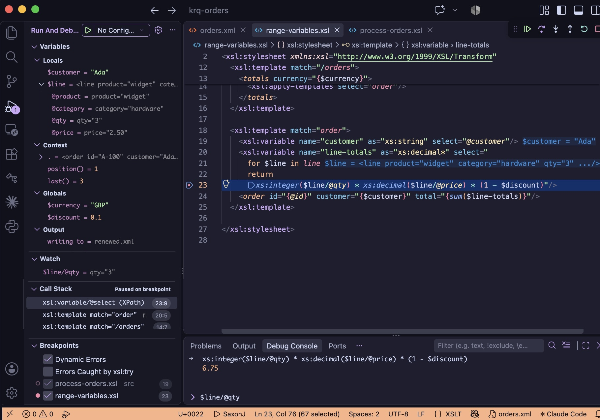
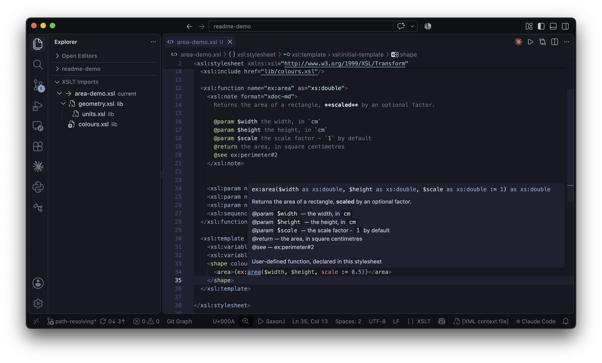
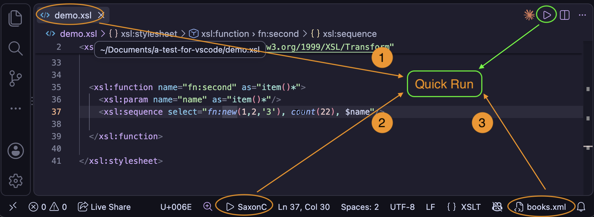

[](https://www.deltaxml.com/?utm_source=VisualStudio&utm_medium=Dev-Tools&utm_campaign=XSLT-XPATH)
# XSLT/XPath for Visual Studio Code

The XSLT/XPath extension for VS Code provides comprehensive language support for XSLT 3.0 and XPath 3.1, and for the XSLT 4.0 and XPath 4.0 features implemented in Saxon 13.

The aim is to make writing, reviewing and debugging XSLT easier. The extension understands each XPath expression - which names are variables, functions or node tests, and where each is declared, including in imported modules - so problems show as you type, and you can go from any name to its declaration, rename it safely, or step through the expression in the debugger.

**Getting started:**

1. Install the extension and open an XSLT file - editing, highlighting and linting need no setup.
2. To run or debug stylesheets, set `XSLT.tasks.saxonJar` to the path of your Saxon jar (Saxon-HE is fine), with a Java runtime on the PATH.
3. Press **Quick Run** (`⌘⌥R` / `Ctrl+Alt+R`) to run the stylesheet with the XML file you last had open - shown in the status bar, where you can pick another.

See the [XSLT/XPath User Guide](https://deltaxml.github.io/vscode-xslt-xpath/) for the full description of each feature, and [What's New](https://deltaxml.github.io/vscode-xslt-xpath/new-release.html) for this release's highlights.

**Where it goes further:**

- **Debugging inside XPath** - the [debugger](https://deltaxml.github.io/vscode-xslt-xpath/debugger.html) stops within multi-line XPath expressions and inline functions, not only at XSLT instructions - and can [step back](https://deltaxml.github.io/vscode-xslt-xpath/debugger.html#step-back).
- **Schematron as SchXslt2 runs it** - [checked as you type](https://deltaxml.github.io/vscode-xslt-xpath/schematron.html), XML files [validated](https://deltaxml.github.io/vscode-xslt-xpath/schematron.html#validating) with failed assertions in the Problems panel, and [breakpoints and stepping](https://deltaxml.github.io/vscode-xslt-xpath/schematron.html#debugging) at a schema's rules, lets and assertions.
- **XSpec in the editor** - [debug a test](https://deltaxml.github.io/vscode-xslt-xpath/xspec.html#debugging) from the XSpec file or the XSLT, with [coverage](https://deltaxml.github.io/vscode-xslt-xpath/xspec.html#coverage) in the editor's margin and test times in the Test Explorer.
- **XSLT 4.0 as Saxon 13 implements it** - [record and enum types](https://deltaxml.github.io/vscode-xslt-xpath/xslt40-records.html) checked as you type, and [path expressions on JSON](https://deltaxml.github.io/vscode-xslt-xpath/xslt40-jnodes.html).
- **Checks that understand XPath** - every variable, function and template reference is checked as you type, across imported modules, without compiling the stylesheet.
- **Profiling in the editor** - [times shown at each template and function](https://deltaxml.github.io/vscode-xslt-xpath/profiler.html), with earlier profiles to compare (Saxon-PE/EE).
- **Documentation in the code** - [notes](https://deltaxml.github.io/vscode-xslt-xpath/xslt40-notes.html) in Markdown, with Javadoc-style tags such as `@param` and `@see`, shown in hover help wherever a function or template is used, and checked against its parameters - in XSLT 3.0 too.
- **Help moving to packages** - [Analyse as Package](https://deltaxml.github.io/vscode-xslt-xpath/xslt-packages.html#converting) shows what would change before a library becomes a package. Packages in the workspace are found with no setup, and `xsl:override` declarations are written for you.
- **Ready for AI assistants** - GitHub Copilot, Claude Code and other assistants in VS Code [see the extension's problems](https://deltaxml.github.io/vscode-xslt-xpath/ai-assistants.html) and fix them - and, through its [MCP server](https://deltaxml.github.io/vscode-xslt-xpath/ai-assistants.html#mcp), check files that aren't open, find declarations and references, try XPath on your XML, and get the exact command to run a stylesheet as you do - with a skill that teaches the assistant to use them.
- **Free and open source** - MIT licensed, and running and debugging work with the free Saxon-HE.

**XML schema validation:** this extension checks that XML files are well-formed, but doesn't validate them against an XML Schema, RELAX NG schema or DTD - for that, install [Red Hat's XML extension](https://marketplace.visualstudio.com/items?itemName=redhat.vscode-xml) alongside it. The two work together: XSLT, XSpec and Schematron files are handled by this extension, and while Red Hat's extension is validating XML files, this one doesn't report the same well-formedness problems again. Schema-aware XSLT isn't supported.

---

<p align="center">
  <em>Debugging XSLT with SaxonJ: paused within an XPath expression, with its range variable,<br> the context and global variables, inline values and the call stack:</em>
  
</p>


# Features

The [step-through XSLT debugger](https://deltaxml.github.io/vscode-xslt-xpath/debugger.html) for SaxonJ sets breakpoints and steps through templates, functions and multi-line XPath expressions - including inline functions passed to functions such as `fold-left` - showing variables and the context item as you go.


<table>
<tr>
  <td width="50%" valign="top">
    <h4><a href="https://deltaxml.github.io/vscode-xslt-xpath/xslt40.html">XSLT &amp; XPath languages</a></h4>
    <ul>
      <li><a href="https://www.w3.org/TR/xslt-30/">XSLT 3.0</a> and XPath 3.1</li>
      <li><a href="https://qt4cg.org/2026-01-28/xslt-40/Overview.html">XSLT 4.0</a> and XPath 4.0, as in 
      <a href="https://www.saxonica.com/html/documentation13/changes/v13/xslt40.html">Saxon 13</a></li>
      <li><a href="https://github.com/xspec/xspec">XSpec</a> - first-class language intelligence</li>
      <li><a href="https://deltaxml.github.io/vscode-xslt-xpath/schematron.html">Schematron</a>, checked as SchXslt2 runs it</li>
      <li>SaxonJS interactive extensions (IXSL)</li>
      <li>Open <a href="https://deltaxml.github.io/vscode-xslt-xpath/xpath-queries.html">XPath editor</a> for the active XML file</li>
      <li>Fast semantic highlighting</li>
    </ul>
  </td>
  <td width="50%" valign="top">
    <h4><a href="https://deltaxml.github.io/vscode-xslt-xpath/xslt40-records.html">XSLT 4.0</a></h4>
    <ul>
      <li>Record and enum types, with type-aware checks</li>
      <li>Named item types: <code>xsl:item-type</code></li>
      <li>Full language features for JNodes (JSON)</li>
      <li><code>xsl:switch</code>, with missing-case quick fixes</li>
      <li>Keyword arguments and optional parameters</li>
      <li>Functions in no namespace</li>
    </ul>
  </td>
</tr>
<tr>
  <td width="50%" valign="top">
    <h4><a href="https://deltaxml.github.io/vscode-xslt-xpath/editing-xslt.html#intellisense">Editing</a></h4>
    <ul>
      <li>Context-aware auto-completion, incl. node names</li>
      <li>Signature help and hover help</li>
      <li>Snippets, incl. new stylesheets for 3.0 and 4.0</li>
      <li>Formatting of instructions and multi-line XPath</li>
      <li>Rename symbol, across imported modules</li>
      <li>Semantic highlighting from a full XPath parser</li>
      <li>Code actions for Quick-Fix and Refactoring</li>
    </ul>
  </td>
  <td width="50%" valign="top">
    <h4><a href="https://deltaxml.github.io/vscode-xslt-xpath/debugger.html">Debugging</a></h4>
    <ul>
      <li>Step-through <a href="https://deltaxml.github.io/vscode-xslt-xpath/debugger.html">XSLT debugger</a> (SaxonJ)</li>
      <li>Per-line tracing of multi-line XPaths</li>
      <li>Conditional Breakpoints or Logpoints</li>
      <li>Views for globals, locals, context and output</li>
      <li>Watch expressions and debug console</li>
      <li>Output mapped to its XSLT and input node; input nodes to their templates</li>
      <li>Formatted and colorised print debugging</li>
    </ul>
  </td>
</tr>
<tr>
  <td width="50%" valign="top">
    <h4><a href="https://deltaxml.github.io/vscode-xslt-xpath/editing-xslt.html#checking">Linter</a></h4>
    <ul>
      <li>XPath syntax and XSLT instructions</li>
      <li>Types, records, enums and function arguments</li>
      <li>Unused XSLT and XPath variables or parameters</li>
      <li>References across imported modules</li>
      <li>Saxon errors from runs, in the Problems panel</li>
      <li>Quick fixes for common problems</li>
      <li><a href="https://deltaxml.github.io/vscode-xslt-xpath/ai-assistants.html#mcp">MCP server</a> for AI assistants, with a skill for Copilot and Claude Code</li>
    </ul>
  </td>
  <td width="50%" valign="top">
    <h4><a href="https://deltaxml.github.io/vscode-xslt-xpath/navigation.html">Navigation</a></h4>
    <ul>
      <li>Go to (or peek) definition, and find references</li>
      <li>Go to the declarations of record fields</li>
      <li>Outline, breadcrumbs and Go to Symbol</li>
      <li><i>Find nodes</i> in XML with a fully featured <a href="https://deltaxml.github.io/vscode-xslt-xpath/xpath-queries.html">XPath editor</a></li>
      <li>Links for <code>xsl:import</code> and <code>xsl:include</code></li>
      <li>XSLT Imports view, with inferred top-level stylesheets</li>
      <li>Filterable dropdown listing all symbols and modes</li>
    </ul>
  </td>
</tr>
<tr>
  <td width="50%" valign="top">
    <h4><a href="https://deltaxml.github.io/vscode-xslt-xpath/refactoring-xslt.html">Refactoring</a></h4>
    <ul>
      <li>Context-aware with safe symbol renaming</li>
      <li>Extract <code>xsl:function</code> or <code>xsl:template</code></li>
      <li>Extract <code>xsl:variable</code> from an XPath expression</li>
      <li>Extract a record type from a map</li>
      <li><strong>Wrap with...</strong> an instruction (<code>⌥⇧W</code> / <code>Alt+Shift+W</code>)</li>
      <li>Add a documentation note</li>
    </ul>
  </td>
  <td width="50%" valign="top">
    <h4><a href="https://deltaxml.github.io/vscode-xslt-xpath/quick-run.html">Running XSLT</a></h4>
    <ul>
      <li><strong>Quick Run</strong> (<code>⌘⌥R</code> / <code>Ctrl+Alt+R</code>)</li>
      <li>Tasks for SaxonJ, SaxonJS and SaxonC</li>
      <li>Required <code>xsl:param</code> values asked for when a task runs</li>
      <li><code>xsl:param</code> values controlled by tasks</li>
      <li>XML catalogs for <code>xsl:import</code> URIs</li>
      <li>File pickers for task inputs</li>
    </ul>
  </td>
</tr>
<tr>
 <td width="50%" valign="top">
    <h4><a href="https://deltaxml.github.io/vscode-xslt-xpath/xslt40-notes.html">Code documentation</a></h4>
    <ul>
      <li><code>xsl:note</code> with Markdown and xqDoc-style tags</li>
      <li>Shown in hover and signature help</li>
      <li><code>@see</code> references, with navigation and rename</li>
      <li>Checks of <code>@param</code> and <code>@field</code> tags</li>
      <li>Module notes for stylesheets</li>
      <li>Highlighting and auto completion for tags or references</li>
    </ul>
  </td>
  <td width="50%" valign="top">
    <h4><a href="https://deltaxml.github.io/vscode-xslt-xpath/xspec.html">Testing XSLT</a></h4>
    <ul>
      <li><a href="https://github.com/xspec/xspec">XSpec 4.1.2</a> test framework built in</li>
      <li>Run, debug and run with coverage from Test Explorer</li>
      <li>Advanced language support within XSpec editor</li>
      <li>Add debug breakpoints direct in XSpec file</li>
      <li>Generate XSpec tests for functions, templates or Schematron rules</li>
      <li>Navigate between tests and the associated XSLT</li>
    </ul>
  </td>
</tr>
</table>

<p align="center">
  <em>XSLT 4.0 with a documentation note, its hover help where the function is called, and the XSLT Imports view:</em>
  
</p>

# Running XSLT



*(1) XSLT in active editor, (2) the Saxon processor, (3) the XML context file - click the play button to run*

The quickest way to run the stylesheet in the active editor is [Quick Run](https://deltaxml.github.io/vscode-xslt-xpath/quick-run.html) (`⌘⌥R` / `Ctrl+Alt+R`): the first run creates a task for you, which later runs reuse.

XSLT transforms for SaxonJ, SaxonJS and SaxonC are configured and run as special VS Code tasks. 

XSLT task JSON properties can reference special commands. The special commands allow file-selection via a File Explorer or 'Recent Files' list, an example using: `"xsltFile": "${command:xslt-xpath.pickXsltFile}"`. The **XSLT: Add XSLT Inputs to Tasks File** command adds inputs for file-selection prompts to `tasks.json`.

For a full description of using VS Code tasks to run XSLT, see [Running XSLT](https://deltaxml.github.io/vscode-xslt-xpath/run-xslt.html).

## Debugging XSLT

Stylesheets can be debugged with SaxonJ (Saxon 12 or later, any edition, including Saxon-HE): set breakpoints in the stylesheet, then use **XSLT: Debug Stylesheet with SaxonJ** (the debug button in the editor title, or `F5` with no `launch.json`). The stylesheet runs as Quick Run runs it - with the XML context file, or from `xsl:initial-template` - using the Quick Run task's settings.

Where Saxon's standard tracing stops at XSLT instructions, this debugger uses Saxon's own APIs to inject extra trace points and re-parse XPath to locate sub-expressions, so it can stop deep inside multi-line expressions and inline functions.

- Add debugger breakpoints or logpoints to almost any line of interest - from an XSLT instruction to deep within an XPath sub expression or inline function
- Line breakpoints, with conditions, hit counts and logpoints (`{$*}` in a logpoint's message logs the local variables) - and function breakpoints, for stylesheet functions and named templates
- Step Over, Step Into and Step Out - including line by line through multi-line XPath expressions, and into inline functions
- Local and global variables, the context item, `current-group()` and `regex-group()` - and their values inline, while paused
- XPath evaluation in the Watch view, the Debug Console and on hover, where execution is paused
- Pause execution on dynamic errors, and the output written so far
- After a run, hover over an element in the input file to see the template rules that processed it, and go to them - and from the output, go to the input it was written for

See [XSLT Debugger](https://deltaxml.github.io/vscode-xslt-xpath/debugger.html) in the User Guide for the full description - including `launch.json` configurations, limitations and troubleshooting.

# Release Notes

The project changelog is maintained on the project wiki. See [Release Notes](https://github.com/DeltaXML/vscode-xslt-tokenizer/wiki/Release-Notes).

# Extension Settings

Editing and linting need no settings. Running and debugging stylesheets need the path of a Saxon processor (see below).
This section outlines the main settings associated with XSLT features.

For more details on how these settings are managed within VS Code see: [VS Code Settings](https://code.visualstudio.com/docs/getstarted/settings)

## XSLT Tasks

To use the task-provider for the _Java_ Saxon XSLT Processor, the following setting is required (alter path to suit actual jar location):

```
  "XSLT.tasks.saxonJar": "/path/to/folder/SaxonHE12-9J/saxon-he-12.9.jar"
```

To use the task-provider for SaxonC, set the path of the folder containing the SaxonC command-line `Transform` executable:

```
  "XSLT.tasks.saxonCPath": "/path/to/folder/containing/Transform"
```

## XSLT 4.0 Tasks

XSLT 4.0 requires Saxon-PE or Saxon-EE (or the equivalent SaxonC edition). The task property `allowSyntaxExtensions40` defaults to `"auto"`, which enables XPath 4.0 syntax unless the processor is Saxon-HE.

When the `parse-html()` function is used, the following setting is also needed, e.g.:

```
  "XSLT.tasks.htmlParserJar": "/path/to/folder/htmlparser-1.4.jar" // or: nu.validator.jar
```

## XSLT Packages

Packages in the workspace are found from their `xsl:package` name and version, with no setup, and passed to Saxon with `-lib` when a stylesheet that uses them runs. For packages outside the workspace, add them to the `XSLT.resources.xsltPackages` setting - each one's name and version are read from its `xsl:package` element, unless given:

```json
"XSLT.resources.xsltPackages": [
       { "path": "/path/to/shared/package.xsl" }
]
```

A relative path is resolved from the first workspace folder. See [XSLT Packages](https://deltaxml.github.io/vscode-xslt-xpath/xslt-packages.html) in the User Guide.

## Editor Settings for Highlighting in Color Theme Extensions

Syntax highlighting is currently only enabled by default in VS Code's built-in themes. This is because some extension themes may not yet have specific language support for VS Code's 'Semantic Highlighting' as used by this extension.

To enable syntax highlighting for a custom theme you need to change User Settings. A set of dark color themes, specially enhanced
for XSLT, are provided by the [XSLT Dark Themes](https://marketplace.visualstudio.com/items?itemName=deltaxml.xslt-dark-themes) extension. 

You can also customize
XSLT token colors. For example, to enable syntax highlighting for XSLT and add some customizations in the [Gruvbox Material Dark](https://marketplace.visualstudio.com/items?itemName=sainnhe.gruvbox-material) theme you could use:
```json
  "editor.semanticTokenColorCustomizations": {
    "[Gruvbox Material Dark]": {
      "enabled": true,
      "rules": {
        "xmlPunctuation": "#b75a1e",
        "anonymousFunction": "#d3869b",
        "xmlText": "#928374",
        "attributeNameTest": "#89b482",
        "elementName": "#d3869b"
      },
    }
  },
  ```

Or, to enable syntax highlighting for all themes:

```json
  "editor.semanticHighlighting.enabled": true,
  ```

## Editor Settings For Word Selection/Navigation

As in XPath, a name like `$two-parts`, `f:line-total` or `xsl:value-of` is one word for completion, the debugger's hovers, highlighting its other occurrences and finding it (e.g. `Cmd+D` / `Ctrl+D`).

For word selection and navigation (e.g. double-click, or `Alt`/`Ctrl` + arrow keys), the extension's default `editor.wordSeparators` setting keeps names like `two-parts` together, but separates `$` and a prefix's `:`. This behaviour can be altered using the VS Code setting:

`editor.wordSeparators`

See: [VS Code Documentation on Settings](https://code.visualstudio.com/docs/getstarted/settings)

___

_Project Sponsor Message:_

[](https://www.deltaxml.com/?utm_source=VisualStudio&utm_medium=Dev-Tools&utm_campaign=XSLT-XPATH)

>DeltaXignia specialise in management of change in structured content with solutions including XML and JSON compare and merge. Whether you are working with documents, data or code, DeltaXignia’s solutions provide the most reliable, efficient and accurate comparison and merge functions for managing structured content. <p>Comprehensive API’s, configurable output formats and full audit trail capabilities make DeltaXignia’s products perfect for integration with your current content management workflows or for embedding within existing editing and publishing products.
